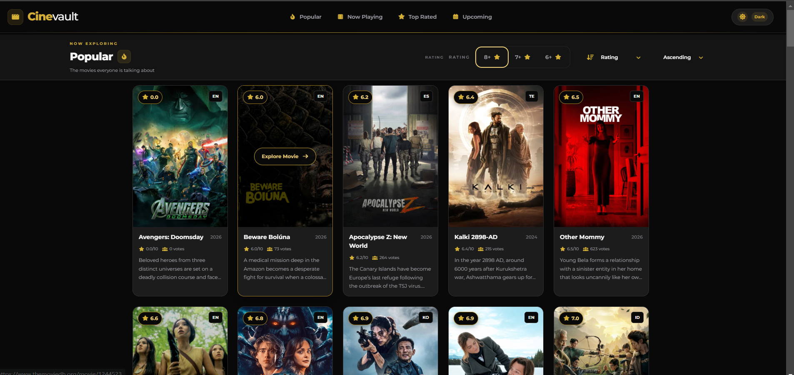
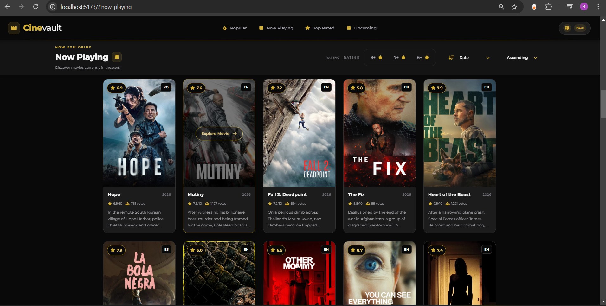

# CineVault

> A cinematic movie discovery interface for browsing popular, in-theaters, top-rated, and upcoming films.

CineVault is a responsive React single-page application powered by The Movie Database (TMDB) API. It presents movie collections in a focused, poster-first layout with per-collection rating filters, sorting controls, deep links to TMDB movie pages, and a persistent light/dark theme.

**Repository:** [github.com/Basel-Amr/cinevault-movie-discovery-app](https://github.com/Basel-Amr/cinevault-movie-discovery-app)

[](https://react.dev/)
[](https://vite.dev/)
[](https://tailwindcss.com/)
[](https://developer.mozilla.org/en-US/docs/Web/JavaScript)

## Contents

- [Overview](#overview)
- [Features](#features)
- [Technology](#technology)
- [Screenshots and assets](#screenshots-and-assets)
- [Getting started](#getting-started)
- [Environment variables](#environment-variables)
- [Project structure](#project-structure)
- [Architecture and implementation](#architecture-and-implementation)
- [User workflow](#user-workflow)
- [Responsive design and UX](#responsive-design-and-ux)
- [Testing and quality](#testing-and-quality)
- [Known limitations and future improvements](#known-limitations-and-future-improvements)
- [Learning outcomes](#learning-outcomes)
- [Author](#author)
- [License](#license)

## Overview

CineVault is designed for users who want a quick way to scan current movie availability and discover films worth exploring. The application loads four TMDB collections:

- Popular movies
- Movies currently playing in theaters
- Top-rated movies
- Upcoming movies

Each collection is rendered as a responsive movie-card grid. A sticky toolbar follows the active collection and lets users filter by minimum rating, sort by release date or rating, and choose ascending or descending order.

## Features

- TMDB bearer-token integration for popular, now-playing, top-rated, and upcoming movie endpoints.
- Lazy-loaded TMDB poster images with a fallback state when a poster is unavailable.
- Movie cards showing title, release year, rating, vote count, original language, and overview.
- Links from each card to the corresponding TMDB movie details page.
- Minimum rating filters for all movies, 6+, 7+, and 8+.
- Sorting by release date or rating, in ascending or descending order.
- Independent filter and sort settings for every movie collection.
- Scroll-aware navigation that tracks the collection currently in view.
- Sticky navigation and collection toolbar for easier browsing.
- Persistent light/dark theme preference using `localStorage`.
- Loading, API error, and empty-filter-result states.
- Responsive grid layouts for desktop, tablet, and mobile widths.
- Keyboard-aware dropdown behavior, focus-visible states, reduced-motion support, and semantic button/link attributes.

## Technology

| Area         | Verified implementation                                                       |
| ------------ | ----------------------------------------------------------------------------- |
| UI           | React 19 with JSX                                                             |
| Build tool   | Vite 8 and `@vitejs/plugin-react`                                             |
| Styling      | CSS by component, Tailwind CSS v4 Vite integration, and CSS custom properties |
| Data source  | TMDB REST API v3                                                              |
| State        | React `useState`, `useEffect`, `useMemo`, Context API, and `localStorage`     |
| Icons        | Font Awesome Free                                                             |
| Typography   | Local Montserrat WOFF2 font                                                   |
| Code quality | ESLint with React Hooks and React Refresh plugins                             |

## Screenshots and assets

The repository includes screenshots of the movie discovery experience and a short demonstration video.

### Popular movies



### Now playing



### Demonstration video

[Watch the CineVault demonstration video](src/assets/Outputs/demo_video.mp4)

The other available visual assets are:

- `src/assets/images/logo.jpg` — project logo used by the application favicon.
- `public/favicon.svg` — public favicon asset.
- `public/icons.svg` — public SVG icon asset.
- `src/assets/fonts/Montserrat.woff2` — bundled application font.

## Getting started

### Prerequisites

- Node.js with npm installed.
- A TMDB account and a TMDB API read access token.

### Installation

```bash
git clone https://github.com/Basel-Amr/cinevault-movie-discovery-app.git
cd moviemaniac
npm install
```

Create a local environment file as described below, then start the development server:

```bash
npm run dev
```

The project also includes `run.bat`, which runs the same development command on Windows.

### Production build

```bash
npm run build
npm run preview
```

## Environment variables

The application reads one client-side Vite environment variable. Create a `.env` file in the project root:

```env
VITE_TMDB_READ_ACCESS_TOKEN=your_tmdb_read_access_token
```

The token is sent as a bearer token to TMDB movie endpoints. The existing `.gitignore` excludes `.env`; never commit the real token or place it in documentation.

## Project structure

```text
moviemaniac/
├── public/
│   ├── favicon.svg
│   └── icons.svg
├── src/
│   ├── assets/
│   │   ├── Outputs/
│   │   │   ├── demo_video.mp4
│   │   │   ├── Most_Popular.png
│   │   │   └── Now_Playing.png
│   │   ├── fonts/Montserrat.woff2
│   │   └── images/logo.jpg
│   ├── components/
│   │   ├── DarkMode/
│   │   ├── MovieList/
│   │   ├── MovieToolbar/
│   │   └── Navbar/
│   ├── context/ThemeContext.jsx
│   ├── styles/
│   │   ├── App.css
│   │   ├── index.css
│   │   ├── themes.css
│   │   └── utilities.css
│   ├── App.jsx
│   └── main.jsx
├── eslint.config.js
├── index.html
├── package.json
├── run.bat
└── vite.config.js
```

## Architecture and implementation

The application uses a component-oriented React structure:

1. `main.jsx` mounts the app and wraps it in `ThemeProvider`.
2. `App.jsx` owns the four collection definitions, the active section, and each collection's filter/sort settings.
3. `Navbar` provides anchor navigation and the theme toggle.
4. `MovieToolbar` renders the active collection title plus rating and sort controls.
5. `MovieList` fetches one TMDB collection, handles request lifecycle state, filters results, and memoizes sorting.
6. `MovieCard` presents normalized TMDB movie fields and links to TMDB details.

Each `MovieList` creates an `AbortController` so an in-flight request is cancelled when the component unmounts or its collection type changes. Filtering and sorting are derived from fetched data with `useMemo`, while `App` preserves independent settings for all four categories.

Theme state is shared through React Context. The provider reads `cinevault-theme` from `localStorage`, applies the selected theme through the document's `data-theme` attribute, and saves subsequent changes. Design tokens in `themes.css` supply dark and light color palettes, spacing, shadows, radii, and transition values.

## User workflow

1. Open the app with a valid TMDB read access token configured.
2. Browse the four movie collections from the navigation bar or by scrolling.
3. Use the active toolbar to select a minimum rating.
4. Choose a sort field and sort direction.
5. Open a movie card to visit its TMDB movie details page.
6. Toggle between dark and light modes; the preference remains available on the next visit in the same browser storage context.

## Responsive design and UX

The movie grid adapts from five columns on large screens to four, three, and two columns at smaller breakpoints. Navigation becomes horizontally scrollable on mobile, and labels are hidden on very small screens to preserve space. The toolbar changes from a horizontal layout to a stacked layout on mobile.

Interactive elements include visible focus styles, ARIA labels, pressed states for filters, menu semantics for sorting controls, Escape-to-close behavior, and outside-click dismissal. Hover-only overlays and action controls are disabled or made visible appropriately for touch devices. Reduced-motion media queries turn off or reduce transitions and animations.

## Testing and quality

Available scripts:

```bash
npm run lint
npm run build
```

The production build was verified successfully. The current lint command reports nine existing errors: unused `React` imports in JSX modules and the React Refresh warning for the exported `useTheme` hook in `ThemeContext.jsx`. No automated unit, integration, or end-to-end test suite is configured in the repository.

## Known limitations and future improvements

The following items are not currently implemented or verified:

- No application-level search, authentication, backend, database, or user account system.
- No favorites or watchlist UI is wired into the rendered app. `MovieCard` accepts optional callbacks for those actions, but the current parent components do not provide them.
- No pagination or infinite scrolling; each collection displays the TMDB response currently returned by its endpoint.
- No local movie-data cache beyond the persisted theme preference.
- No verified deployment configuration or live demo URL.
- No automated test suite.

Potential next steps include adding search and pagination, wiring favorites/watchlists to a persistent store, extracting the TMDB client into a dedicated service, adding automated tests, improving lint configuration for the React compiler setup, and introducing an error boundary or retry controls for API failures.

## Learning outcomes

This project demonstrates practice with React component composition, Context API state sharing, effect cleanup for network requests, derived state with memoization, REST API consumption, responsive CSS, CSS theme tokens, local storage persistence, accessibility-oriented interactions, and Vite-based production builds.

## Author

**Basel Amr** — Frontend / Full Stack Developer

Cairo, Egypt

- [GitHub](https://github.com/Basel-Amr)
- [LinkedIn](https://www.linkedin.com/in/baselamrbarakat)
- [HackerRank](https://www.hackerrank.com/profile/BaselAmr1998)
- [Kaggle](https://www.kaggle.com/baselamr1998)

## License

No license has been specified for this project yet.
